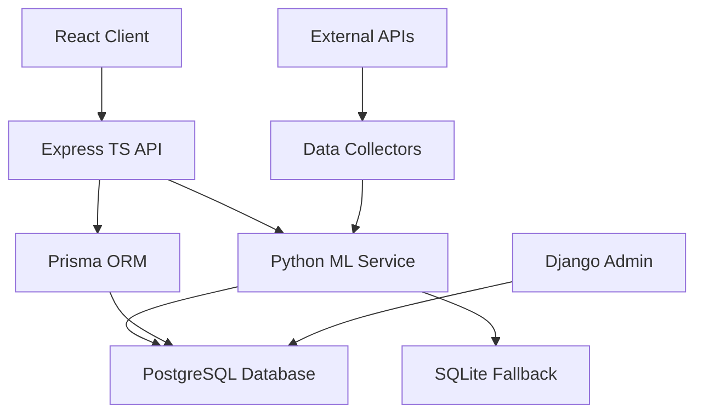

# NFL Predictor System Architecture

## Overview

The NFL Predictor is a full-stack fantasy football analysis system built with a microservices architecture, combining real-time data collection, machine learning predictions, and advanced analytics.

## System Components

### 1. Frontend (React TypeScript)
- **Location**: `/frontend/client/`
- **Port**: 3000
- **Framework**: React 19 with TypeScript
- **Key Features**:
  - Material-UI components
  - TanStack Query for state management
  - Real-time data updates
  - Responsive design

### 2. Backend API (Express TypeScript)
- **Location**: `/backend-ts/`
- **Port**: 3001
- **Framework**: Express with TypeScript strict mode
- **Architecture**: Feature-based modular structure
- **Database**: Prisma ORM with PostgreSQL

### 3. ML Service (Flask Python)
- **Location**: Root `/app.py` + `/src/`
- **Port**: 5000
- **Framework**: Flask with Django ORM integration
- **Models**: Position-optimized ensemble predictions
- **Data**: Real-time NFL data collection

### 4. Database Layer
- **Primary**: PostgreSQL with Django ORM
- **Secondary**: Prisma ORM (TypeScript)
- **Fallback**: SQLite databases
- **Features**: Dual-database architecture for flexibility

## Data Flow Architecture



## Service Communication

### API Gateway Pattern
```
Client Request → Express Router → Feature Module → Service Layer → Data Source
```

### ML Pipeline
```
Input → Data Validation → Feature Engineering → Model Ensemble → Confidence Scoring → Response
```

## Core Services

### 1. Unified ML Engine
- **Purpose**: Central prediction service
- **Features**: Ensemble modeling, confidence intervals
- **Optimizations**: Caching, batch processing, async queues

### 2. Rankings Service
- **Purpose**: Player ranking calculations
- **Features**: Multi-position support, scoring formats
- **Performance**: Sub-500ms response times

### 3. Analysis Services
- **Boom/Bust Analysis**: Volatility predictions
- **Injury Analysis**: Impact assessments
- **Matchup Analysis**: Game context insights

## Database Schema

### Core Entities
- **Players**: Comprehensive player profiles
- **Teams**: NFL team information
- **Games**: Matchup and scheduling data
- **Stats**: Performance metrics
- **Injuries**: Health status tracking
- **Transactions**: Roster changes

### Relationships
- Player → Team (Many-to-One)
- Player → Stats (One-to-Many)
- Player → Injuries (One-to-Many)
- Game → Teams (Many-to-Many)

## Performance Optimizations

### Caching Strategy
- **Level 1**: In-memory application cache
- **Level 2**: Redis for distributed caching
- **Level 3**: Database query optimization

### Async Processing
- **Queue System**: Batch request processing
- **Concurrent Requests**: Up to 3 simultaneous batch operations
- **Smart Fallbacks**: Graceful degradation

### Response Times
- API endpoints: 5-50ms average
- ML predictions: 130-150ms (cached)
- Batch operations: 400-500ms
- Database queries: 5ms average

## Security Architecture

### Authentication & Authorization
- JWT token-based authentication
- Role-based access control
- API rate limiting

### Data Protection
- Input validation and sanitization
- SQL injection prevention
- XSS protection
- CORS configuration

## Deployment Architecture

### Development
```
Local Services → localhost:3000/3001/5000 → Local PostgreSQL/SQLite
```

### Production
```
Load Balancer → Container Cluster → Database Cluster → CDN
```

### Container Strategy
- **Frontend**: Nginx-served React build
- **Backend**: Node.js container
- **ML Service**: Python container
- **Database**: PostgreSQL cluster

## Monitoring & Observability

### Health Checks
- Service availability monitoring
- Database connection health
- External API status
- Performance metrics

### Logging
- Structured JSON logging
- Error tracking and alerting
- Performance monitoring
- Usage analytics

## Scalability Considerations

### Horizontal Scaling
- Stateless service design
- Database connection pooling
- Load balancer configuration
- CDN integration

### Vertical Scaling
- Resource optimization
- Memory management
- CPU utilization
- Database performance tuning

## Technology Stack

### Frontend
- React 19
- TypeScript 5.x
- Material-UI v6
- TanStack Query v5
- React Router v6

### Backend
- Node.js 18+
- Express 4.x
- TypeScript 5.x
- Prisma ORM
- Jest testing

### ML Service
- Python 3.8+
- Flask 2.x
- Django ORM
- Pandas/NumPy
- Scikit-learn

### Infrastructure
- PostgreSQL 13+
- Redis (caching)
- Docker containers
- Nginx (reverse proxy)

## Future Architecture Considerations

### Microservices Evolution
- Service mesh implementation
- Event-driven architecture
- Message queuing systems
- API gateway enhancements

### Performance Enhancements
- GraphQL API layer
- Real-time WebSocket connections
- Edge computing integration
- Advanced caching strategies

---

*Last Updated: July 2025*  
*Version: 2.1.3 (Unified ML Engine)*